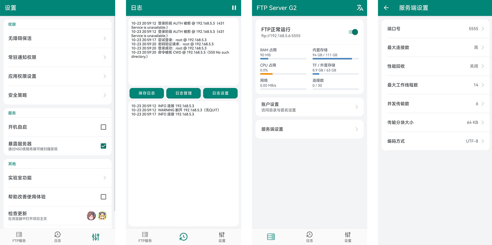

# FTP Server G2

FTP Server G2 可以把 Android 手机变成 FTP 文件服务器，方便在同一网络内用电脑或其他设备访问手机文件。

## 主要功能

- 提供 FTP 文件服务，并支持 FTPS 加密连接。
- 创建多个账户，为每个账户设置访问目录和读写权限，也可按需启用匿名访问。
- 查看连接状态、当前连接数、资源占用及运行日志，便于了解服务情况和排查问题。
- 配置服务端口、并发连接数、同时传输数和传输分块大小。
- 支持 IPv6，并提供访问控制选项，按需限制可连接的设备。
